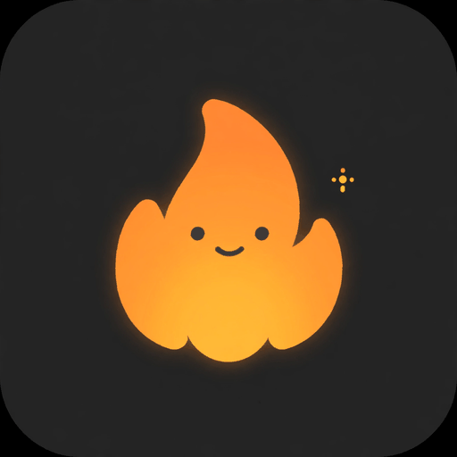

# Iskra (Искра)

[English](README.md) | [Русский](README.ru.md) | **한국어**



**처음부터 Rust로 만든 가벼운 개인 AI 에이전트.**
*Iskra*(Искра)는 러시아어로 "불꽃" — 모든 것이 시작되는 작은 불씨라는 뜻입니다.


Iskra는 메신저 안에 살면서 재시작해도 기억을 유지하고, 엄격한 권한 경계 안에서 도구를 사용하며, 분해와 재조립을 전제로 설계된 개인 에이전트입니다 — 코어를 건드리지 않고 모델, 창구, 도구를 갈아 끼울 수 있습니다.

> **상태:** v1 개발 중. 터미널 기반 코어 루프, 파일 도구, 기억은 오늘 동작하고, 텔레그램 창구가 다음입니다.
> 이 저장소에는 코드만 있습니다 — 개인 기억, 데이터, 비밀값은 여기에 두지 않습니다.

## 설계 원칙

1. **희망이 아니라 예산으로 가볍게** — 단일 바이너리, 크기와 유휴 메모리, 의존성 개수에 하드 리밋을 걸고 릴리스마다 측정합니다.
2. **규격으로 모듈화** — 두뇌, 창구, 도구, 기억은 버전이 있는 인터페이스 규격(`brain/v1`, `channel/v1`, `tool/v1`, `memory/v1`)으로 연결됩니다. 확장은 코어 수정이 아니라 부품 추가입니다.
3. **fail-closed 안전** — 도구는 샌드박스 폴더 안에서만 돌고, 셸 접근은 허용 목록만, 비밀값은 로그와 기억에 구조적으로 들어갈 수 없으며, 되돌릴 수 없는 행동은 사람의 승인이 필요합니다.
4. **원가 규율** — 반복 작업은 모델 호출 없이 도는 절차로 결정화합니다. 비싼 감각(화면)은 최후 수단이고, 구조화 통로(API · DOM)가 먼저입니다.
5. **읽을 수 있는 기억** — 장기 기억은 로드 예산이 있는 평범한 마크다운이며, 저장 시 자격증명을 가리고, 감염 방어를 갖췄습니다: 밖에서 온 내용은 소유자 검토 없이 핵심 기억에 들어가지 않습니다.

## 현재 상태 (v1)

- [x] Rust 골격 + DeepSeek 두뇌 (SDK 없이 HTTP 직접 호출)
- [x] 멈춤 조건이 있는 대화 루프 (도구 왕복 상한, 같은 오류 반복 시 정지)
- [x] `workspace/`로 샌드박스된 파일 도구 (`read_file`, `write_file`)
- [x] 예산 로드 + 가림 저장되는 마크다운 기억, 정체성 파일 (SOUL.md / USER.md)
- [ ] 발신자 허용 목록이 있는 텔레그램 창구
- [ ] 허용 목록 셸 도구 + 검증된 코딩 과제

## 로드맵

| 버전 | 방향 |
|---|---|
| v1 | 한 사람을 위한 개인 에이전트 (텔레그램, 두뇌 1개, 도구 4개, 마크다운 기억) |
| v2 | 갈아끼우는 부품 — 규격 정식화, 두뇌 복수화, 결정 모델 라우팅 |
| v3 | 일을 맡기는 에이전트 — 트리거, 봇 패키지, 신원 규격 (`identity/v1`) |
| v4 | 데스크톱 앱 (Tauri) — 멀티봇, 승인 게이트 뒤의 컴퓨터 유즈 |
| v5 | 제품화 — 호스티드 모드, 사용자별 기억 + 어댑터 서빙, 서명 릴리스 |

## 빠른 시작

```bash
git clone https://github.com/jeonghoheo/iskra.git
cd iskra
cp .env.example .env   # DEEPSEEK_API_KEY를 넣으세요
cargo run
```

## 라이선스

**Functional Source License, Version 1.1 (FSL-1.1-ALv2)** 로 소스 공개 — [LICENSE](LICENSE) 참조. 자유롭게 사용, 연구, 수정, 셀프호스팅할 수 있습니다. 다만 경쟁하는 상업 제품이나 서비스로 타인에게 제공하는 것은 허용되지 않습니다. 각 릴리스는 공개 2년 후 Apache 2.0으로 전환됩니다.
